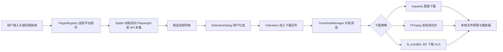

# UniversalCrawler 多平台媒体采集与下载管理器


> 一个基于 Python、PyQt6 和 Playwright 的桌面端媒体采集与下载管理工具。项目重点不是“下载站点本身”，而是把浏览器自动化、插件化采集、任务队列、并发下载、本地文件管理和桌面 UI 串成一套完整工程。

## 项目定位

`UniversalCrawler` 是大学阶段的 Python 桌面应用实践项目。它通过插件注册表接入不同平台的采集逻辑，由 PyQt6 提供深色主题界面，使用 Playwright 完成登录、页面滚动、链接嗅探和 Cookie 持久化，再交给下载管理器并发处理文件下载、音视频合并和本地播放。

当前 UI 默认注册的平台插件：

- `Bilibili`：支持 BV 号、视频链接、搜索词、UP 主空间等入口，解析 DASH 音视频流并调用 FFmpeg 合并。
- `快手`：使用 Playwright 打开页面、保存登录态、滚动扫描列表、生成待下载清单。
- `HLS/M3U8 站点插件`：演示代理配置、列表扫描、m3u8 嗅探和外部下载器接入；公开展示前建议按合规要求移除或改成通用测试站点。

代码中还保留了抖音相关适配代码，但 `PluginRegistry` 当前默认没有注册该插件，不能视为稳定可用功能。

## 核心能力

| 能力 | 实现方式 | 关键文件 |
| --- | --- | --- |
| 桌面应用界面 | PyQt6 主窗口、深色主题、下载队列、日志面板、内置播放器 | `main.py`、`app/ui/main_window.py` |
| 插件化采集 | `PluginRegistry` 管理平台插件，插件提供 UI 参数和 Spider 类 | `app/core/registry.py` |
| 浏览器自动化 | Playwright 处理登录、页面跳转、滚动加载、网络请求监听 | `app/spiders/*.py` |
| 线程通信 | Spider 继承 `QThread`，用 Qt Signal 将日志、候选项和结果回传 UI | `app/spiders/base_spider.py` |
| 任务选择 | 扫描后弹窗勾选目标，再把选中项加入下载队列 | `app/ui/dialogs.py` |
| 并发下载 | `DownloadManager` + `DownloadWorker` + `QSemaphore` 控制并发 | `app/core/download_manager.py` |
| 媒体处理 | requests 流式下载、FFmpeg 音画合并、N_m3u8DL-RE 处理 HLS | `app/core/downloaders.py` |
| 本地管理 | 扫描本地 MP4、表格重命名、播放、删除和进度展示 | `main.py` |
| 命令行入口 | 提供轻量 CLI，可用于 Bilibili 单视频/直链场景测试 | `cli_crawler.py` |

## 技术栈

- 语言：Python
- 桌面界面：PyQt6、Qt Signal/Slot、QThread、QMediaPlayer
- 浏览器自动化：Playwright Chromium
- 网络请求：requests、httpx
- 媒体处理：FFmpeg、N_m3u8DL-RE
- 配置与状态：JSON 配置文件、Cookie 文件、窗口状态持久化

## 目录结构

```text
UniversalCrawler/
├── main.py                       # 桌面端主入口，连接 UI、Spider 和下载管理器
├── cli_crawler.py                # 命令行采集/下载入口
├── kuaishou_single.py            # 快手单独调试脚本
├── requirements.txt              # Python 依赖
├── ffmpeg.exe                    # 本地媒体合并工具，公开仓库建议改为自行下载
├── N_m3u8DL-RE.exe               # HLS 下载工具，公开仓库建议改为自行下载
├── chromium-1200/                # Playwright/Chromium 本地运行缓存
├── Logs/                         # 运行日志
└── app/
    ├── models.py                 # VideoItem 数据模型与配置对象
    ├── utils.py                  # 配置读写、文件名清理等工具
    ├── core/
    │   ├── registry.py           # 插件注册表
    │   ├── download_manager.py   # 下载任务队列与并发控制
    │   ├── downloaders.py        # 不同来源的下载策略
    │   └── lib/douyin/           # 抖音相关第三方/适配代码，当前默认未启用
    ├── spiders/
    │   ├── base_spider.py        # Spider 基类
    │   ├── bilibili_spider.py    # Bilibili 采集逻辑
    │   ├── kuaishou_spider.py    # 快手采集逻辑
    │   ├── missav_spider.py      # HLS/m3u8 站点适配示例
    │   └── douyin_spider.py      # 抖音适配代码，默认未注册
    └── ui/
        ├── main_window.py        # 主界面
        ├── dialogs.py            # 任务选择弹窗
        ├── widgets.py            # 自定义视频控件
        └── styles.py             # 深色主题样式
```

## 架构流程



## 安装与运行

> 本项目更偏 Windows 桌面端；仓库中出现的 `.exe`、`chromium-1200/` 和 `Logs/` 属于本地运行产物，正式开源时建议用 `.gitignore` 排除。

1. 创建 Python 环境。

```bash
python -m venv .venv
.venv\Scripts\activate
```

2. 安装依赖。

```bash
pip install -r requirements.txt
```

3. 安装 Playwright Chromium。

```bash
playwright install chromium
```

4. 准备外部工具。

- Bilibili 音视频合并需要 `ffmpeg.exe`，也可以安装系统版 FFmpeg 并加入 PATH。
- HLS/m3u8 下载需要 `N_m3u8DL-RE.exe`，放在 `main.py` 同级目录。

5. 启动桌面程序。

```bash
python main.py
```

6. 可选：使用命令行入口测试。

```bash
python cli_crawler.py bilibili BVxxxxxx --output downloads
```

## 使用说明

1. 在顶部下拉框选择平台插件。
2. 输入 BV 号、视频链接、UP 主空间、作者主页或关键词。
3. 按需设置插件参数，例如 Bilibili 扫描页数、HLS 插件代理。
4. 点击启动任务，等待 Spider 扫描并弹出候选清单。
5. 勾选要处理的项目后，下载任务进入左侧队列。
6. 下载完成后，可在右侧播放器预览，也可以在表格中重命名或删除本地文件。

## 本轮审查结论

这是一个有工程含量的 Python 桌面应用项目，适合在简历中提炼成“插件化媒体采集与下载管理器”。它的亮点在于：能把 PyQt6 UI、浏览器自动化、Qt 线程通信、下载队列、外部媒体工具和本地文件管理组合起来；相比单脚本爬虫，更能体现工程组织和桌面端开发能力。

适合写进简历的表达：

- 基于 PyQt6 设计桌面端采集与下载管理器，实现插件注册、任务队列、并发下载和本地播放器。
- 使用 Playwright 自动化浏览器完成登录态保存、滚动加载、候选数据采集和网络资源嗅探。
- 设计统一 `VideoItem` 模型与下载策略层，按来源选择 requests、FFmpeg 或 HLS 外部下载器处理不同媒体流。
- 通过 `QThread`、Qt Signal 和 `QSemaphore` 解耦 UI、采集线程和下载线程，减少界面阻塞。

公开展示或继续优化前建议处理：

- README 与窗口标题中的 `Pro` 命名和目录名不一致，后续可统一为 `UniversalCrawler` 或明确版本关系。
- 仓库包含 `ffmpeg.exe`、`N_m3u8DL-RE.exe`、`chromium-1200/` 和日志文件，建议改为安装说明并从仓库排除。
- Cookie、登录态、配置文件、下载目录和运行日志需要加入 `.gitignore`，避免泄露账号或本地路径。
- HLS/成人站点相关插件不适合作为求职主推内容，公开简历项目时建议移除、默认禁用或替换为合规测试源。
- 抖音适配代码存在但默认未注册，README 中应避免宣传为已稳定支持。
- 当前缺少自动化测试，可补充文件名清理、下载器策略选择、配置读写和插件注册表的单元测试。

## 合规说明

本项目仅用于学习 Python 桌面开发、浏览器自动化、网络请求分析和媒体处理流程。请只处理自己拥有权利、已获授权或允许下载的内容，并遵守目标网站服务条款、版权规则和所在地法律法规。项目作者不鼓励也不承担任何未经授权下载、传播或商用行为。

## License

仓库当前未看到独立 `LICENSE` 文件。如需正式开源，建议补充许可证，并确认外部工具、站点适配代码和第三方库的许可边界。
